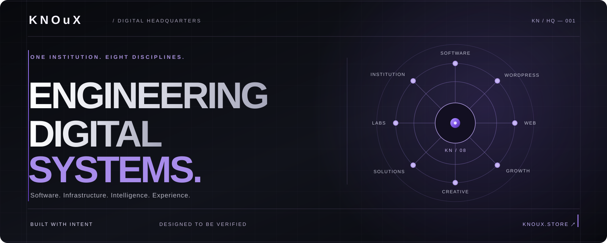
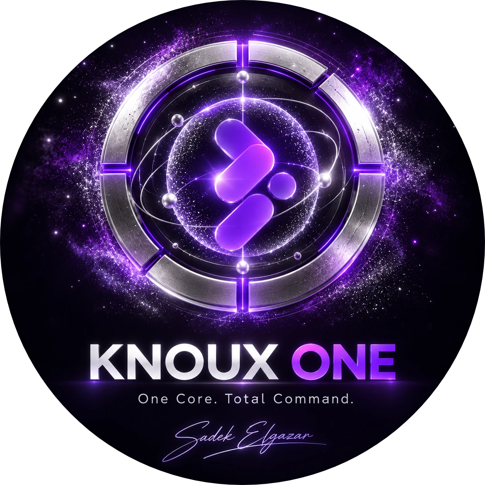
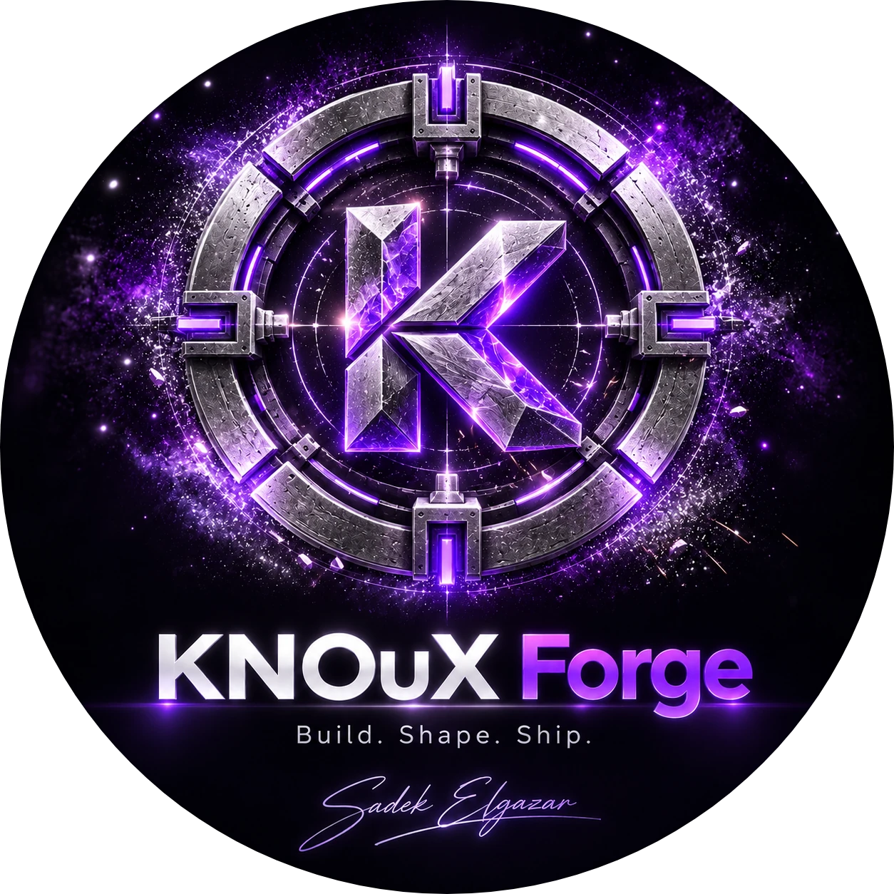
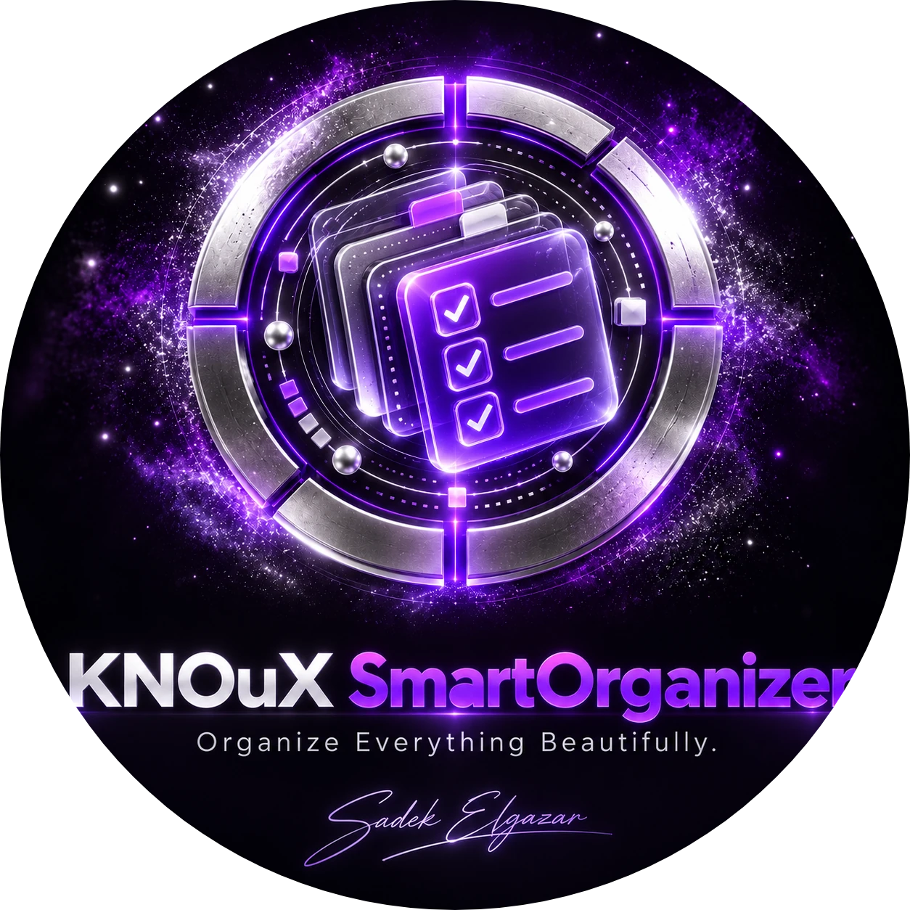
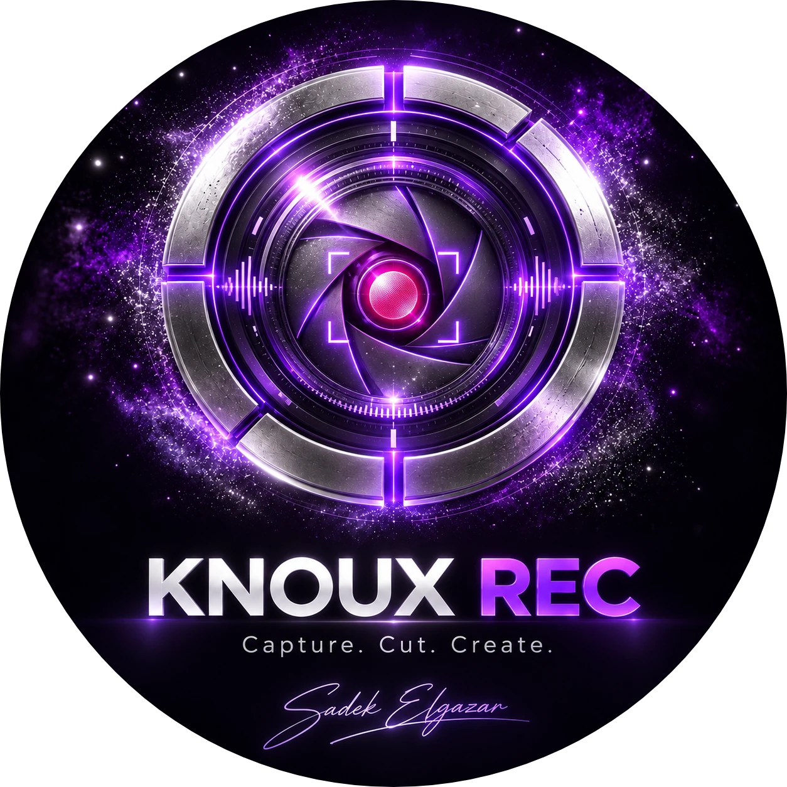
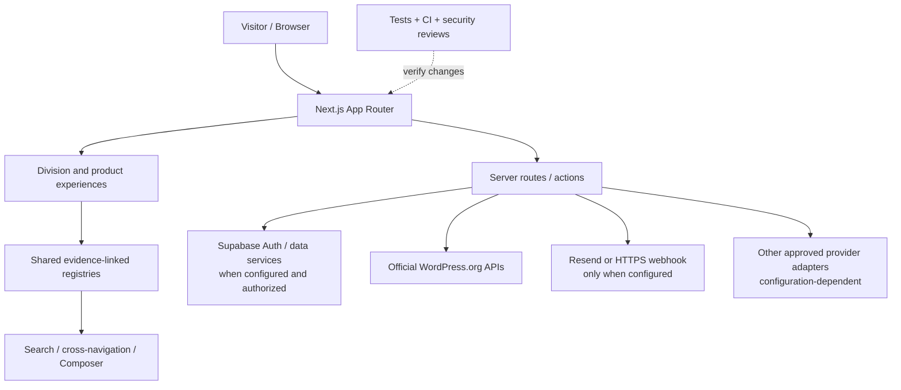

<div align="center">



<br />


# KNOuX — Digital Headquarters

**ONE PRACTICE. EIGHT WINGS. ENGINEERING DIGITAL SYSTEMS.**

A code-first home for KNOuX software, web engineering, WordPress systems, growth, creative work, intelligent tooling and the evidence that supports them.

<p>
  <a href="https://knoux.store"><strong>Explore the Headquarters</strong></a> &nbsp;·&nbsp;
  <a href="https://knoux.store/products">Software Universe</a> &nbsp;·&nbsp;
  <a href="https://knoux.store/build">KNOuX DEV</a> &nbsp;·&nbsp;
  <a href="https://knoux.store/about">The Institution</a> &nbsp;·&nbsp;
  <a href="mailto:admin@knoux.store">Contact</a>
</p>

[](https://github.com/daynightae-cmyk/knoux-store/actions/workflows/ci.yml)

<sub>Next.js 16 · React 19 · TypeScript · Supabase integration · GitHub Actions · Vercel deployment workflow</sub>

</div>

---

> **WE BUILD WHAT WE CAN EXPLAIN. WE PUBLISH WHAT WE CAN DEFEND.**
>
> The interface is only the visible layer. Behind it must be a maintainable system, truthful product data, explicit security boundaries and evidence from real checks.

## Explore this repository

| Discover | Build and verify | Know the institution |
|:---|:---|:---|
| [The institution](#the-institution) | [Architecture](#system-architecture) | [Engineering principles](#engineering-principles) |
| [Eight divisions](#eight-divisions-one-system) | [Technology](#technology-stack) | [Founder](#founder--engineering) |
| [Software universe](#the-software-universe) | [Getting started](#getting-started) | [Official contact directory](#official-contact-directory) |
| [Signature experiences](#signature-experiences) | [Verification](#verification--quality-gates) | [Brand and asset provenance](#brand--asset-provenance) |
| [Visual gallery](#product-identity-gallery) | [Security and integrations](#security--external-integrations) | [FAQ](#frequently-asked-questions) |

<a id="the-institution"></a>
## 01 / The institution

**KNOuX is a digital engineering headquarters, not just a landing page or a catalogue of promises.** It connects the software we build, the systems we engineer, the creative decisions that shape them and the operating practices that make them maintainable.

The website is deliberately structured around **one shared discovery model**. Division catalogues feed a consistent entity registry, search and navigation; the Build Composer maps visitor needs to entries that exist rather than generating imaginary products, prices or case studies.

The live public entry point is **[knoux.store](https://knoux.store/)**. The source repository is **[daynightae-cmyk/knoux-store](https://github.com/daynightae-cmyk/knoux-store)**. Features that require provider accounts, credentials, privileges or deployment-specific services can remain unavailable until those dependencies are genuinely configured.

### What this repository represents

- **An institutional experience:** the home page, about, work, engineering, contact and solutions surfaces.
- **A discoverable product ecosystem:** repository-linked product dossiers and product-specific presentation assets.
- **A composable services directory:** web systems, WordPress, growth, creative disciplines and solutions.
- **A developer workspace:** KNOuX DEV / Build with provider, model, workspace and engineering surfaces.
- **Specialist product areas:** KNOuX Signal and the Growth / Command Center routes.
- **An evidence-bearing codebase:** tests, audits, architectural notes, security reviews and release checks.

**Important distinction:** the presence of a route or interface is not evidence that an external account, checkout, payment, domain registrar, AI inference provider or production delivery transport is operational.

<a id="eight-divisions-one-system"></a>
## 02 / Eight divisions. One system.

The eight primary wings are defined in [`src/lib/entities.ts`](src/lib/entities.ts), not invented for this README.

| Wing | Responsibility | Explore |
|:---|:---|:---|
| **01 · Software** | Desktop systems, developer tools and verified product records | [Products](https://knoux.store/products) |
| **02 · WordPress** | Open-web discovery, WordPress engineering and infrastructure decisions | [WordPress](https://knoux.store/wordpress) |
| **03 · Web** | Institutional sites, commerce architecture, applications and platforms | [Web](https://knoux.store/web) |
| **04 · Growth** | Marketing architecture, channels, instrumentation and campaigns | [Growth](https://knoux.store/growth) |
| **05 · Creative** | Brand identity, interface systems, visual language and motion | [Creative](https://knoux.store/creative) |
| **06 · Solutions** | Needs-led combinations of services and product capabilities | [Solutions](https://knoux.store/solutions) |
| **07 · Labs** | Experiments, emerging ideas and deliberately unfinished work | [Labs](https://knoux.store/labs) |
| **08 · Institution** | The practice, work evidence, principles and team identity | [About](https://knoux.store/about) |

### One connective tissue

A visitor should be able to move from a business need to relevant disciplines, from a product to its underlying evidence, and from a question to a useful next step without browsing eight unrelated microsites. The common entity and route model enables this relationship; individual specialist experiences retain their own identity.

<a id="the-software-universe"></a>
## 03 / The Software Universe

The [software catalogue](src/data/software.ts) is an evidence-linked registry. Its statuses describe how a product is represented in the catalogue; **they do not certify a production installer, successful purchase, complete runtime implementation or customer outcome**.

| Code | System | Focus | Registry status |
|:---|:---|:---|:---|
| SW-01 | **[KNOUX ONE](https://knoux.store/products/knoux-one)** | Windows intelligence and developer suite | `active` |
| SW-02 | **[KNOuX Forge](https://knoux.store/products/kforge)** | Local-first engineering tooling | `active` |
| SW-03 | **[KNOuX Repair](https://knoux.store/products/knoux-repair)** | Windows maintenance and repair | `active` |
| SW-04 | **[KNOuX SmartOrganizer](https://knoux.store/products/knoux-smartorganizer)** | File and workspace organisation | `active` |
| SW-05 | **[KNOuX REC](https://knoux.store/products/knoux-rec)** | Capture and media workflows | `active` |
| SW-06 | **[KNOuX Player X](https://knoux.store/products/knoux-x)** | Desktop media experience | `active` |
| SW-07 | **[KNOuX Clipboard AI](https://knoux.store/products/knoux-clipboard-ai)** | Developer productivity | `release-candidate` |
| — | **KNOuX Quill** | Research entry in the wider software registry | `research` |
| — | **KNOuX Crypt** | Research entry in the wider software registry | `research` |

The first seven are the primary public software presentation; research entries are intentionally distinguished from that showcase. For the authoritative slug, public route, limitations and repository evidence of any product, consult its current record in [`src/data/software.ts`](src/data/software.ts). If a route changes, the registry takes precedence over this document's navigational shortcuts.

### The catalogue's evidence contract

Each software record may declare its repository, platform, implemented or reported capabilities, known limitations, technology, status, version source and related products. A missing version, release or capability stays **unknown** rather than being filled with an attractive guess.

This is not a fabricated customer portfolio. [Work](https://knoux.store/work) documents product and engineering evidence; a client case study requires separate client-specific proof.

<a id="product-identity-gallery"></a>
## 04 / Product identity gallery

<div align="center">

**REAL REPOSITORY ASSETS · DISTINCT SYSTEM IDENTITIES**


</div>

<table>
<tr>
<td width="33%" align="center"><a href="https://knoux.store/products/knoux-one"><br/><strong>KNOUX ONE</strong></a><br/><sub>Windows intelligence</sub></td>
<td width="33%" align="center"><a href="https://knoux.store/products/kforge"><br/><strong>KNOuX Forge</strong></a><br/><sub>Engineering tooling</sub></td>
<td width="33%" align="center"><a href="https://knoux.store/products/knoux-repair"><br/><strong>KNOuX Repair</strong></a><br/><sub>System maintenance</sub></td>
</tr>
<tr>
<td align="center"><a href="https://knoux.store/products/knoux-smartorganizer"><br/><strong>SmartOrganizer</strong></a><br/><sub>File organisation</sub></td>
<td align="center"><a href="https://knoux.store/products/knoux-rec"><br/><strong>KNOuX REC</strong></a><br/><sub>Capture workflows</sub></td>
<td align="center"><a href="https://knoux.store/products/knoux-x"><br/><strong>Player X</strong></a><br/><sub>Desktop media</sub></td>
</tr>
</table>

<sub>Visual assets are tracked in this repository. They are product identity / presentation artwork, **not proof of a running application, customer deployment or verified screenshot**. Product images must not be substituted for actual QA captures.</sub>

<a id="signature-experiences"></a>
## 05 / Signature experiences

### KNOuX DEV — engineering workspace

[Open Build](https://knoux.store/build) · [Explore models](https://knoux.store/build/ai/models) · [Explore providers](https://knoux.store/build/ai/providers)

The `/build` route includes an engineering workspace with specialist interfaces for apps, services, providers, AI models, routing, terminal-oriented tools, documentation and deployment-related workflows. The actual feature boundary is defined by the relevant provider and workspace adapters.

**Connection truth matters:** a listed model is not automatically authenticated, connected, billable, free, locally executable or successfully invoked. Credentials must remain server-side; unsupported operations must remain unavailable.

Relevant architecture: [Provider Operating System](docs/build/PROVIDER_OPERATING_SYSTEM.md) · [Build security](docs/BUILD_SECURITY_MODEL.md) · [Integration setup](docs/build/INTEGRATION_SETUP.md).

### KNOuX Signal — phone identity and reputation

[Open Signal](https://knoux.store/signal) · [Lookup](https://knoux.store/signal/lookup)

Signal has routes for lookup, business identity, claims, number ownership, reputation and privacy controls. Its public evidence handling is purpose- and consent-aware; absence of a matching record must never be presented as proof of a person's identity. Optional external sources require configured providers and lawful provenance.

This README does not promise a universal reverse-phone directory or use of private contact books.

### KNOuX Command — growth operations

[Open Command](https://knoux.store/command) · [Growth](https://knoux.store/growth)

The Command workspace exposes campaign, connection, reporting, social, creative and automation surfaces. Real account connectivity, tenant configuration, approvals and published campaign actions are different states. Demo fixtures must remain visibly differentiated from real client data.

Reference: [Growth architecture](docs/growth/ARCHITECTURE.md) · [Growth security](docs/growth/SECURITY.md).

### WordPress ecosystem — official-source discovery

[Explore WordPress](https://knoux.store/wordpress) · [Plugins](https://knoux.store/wordpress/plugins) · [Themes](https://knoux.store/wordpress/themes) · [Patterns](https://knoux.store/wordpress/patterns)

External discovery uses official WordPress.org sources through guarded server-side adapters, including request bounds, validation, timeouts, caching and explicit unavailable states. Marketplace discovery is **not** the same as a released first-party KNOuX plugin, completed site build, active registrar or executed purchase.

Architecture: [WordPress adapter](src/lib/wordpress/wordpress-org.ts) · [WordPress executor](docs/WORDPRESS-EXECUTOR.md).

### Sentinel — contextual visitor guidance

The site contains a KNOuX Sentinel guide with its own presentation and server-facing contracts. Public assistance must not imply private desktop control, PowerShell execution, direct Git mutation or unauthorized file access. Model-backed answers require a real configured provider and deployment budget controls.

Security notes: [Public companion boundary](docs/COMPANION_SECURITY_AND_PRIVACY.md) · [Architecture](docs/KNOuX_AI_COMPANION_ARCHITECTURE.md).

<a id="system-architecture"></a>
## 06 / System architecture



### The separation that protects the product

1. **Presentation:** page, motion, art direction, navigation, responsive behavior and accessibility.
2. **Domain data:** product, service and solution records with explicit provenance and statuses.
3. **Application contracts:** server routes, validation, search, Composer and integration adapters.
4. **External dependencies:** Supabase, provider APIs, mail transport and WordPress.org — available only when their actual configuration and upstream permit.
5. **Verification:** static analysis, tests, browser checks, CI and production observation; not interchangeable with one another.

A picture of an integration is not an integration. A green build is not a transaction. A service name in configuration is not a live authorization.

<a id="technology-stack"></a>
## 07 / Technology stack

The versions below describe [`package.json`](package.json) on the README authoring baseline, **not** the version of every independent software product in the catalogue.

| Layer | Repository dependency / approach |
|:---|:---|
| Application framework | Next.js 16 / App Router |
| UI | React 19, TypeScript ~5.9 |
| Visual system | CSS, Three.js, React Three Fiber, Drei |
| Data and authentication integration | Supabase JS / SSR (configuration-dependent) |
| Observability | Vercel Analytics package and repository event contracts |
| Developer-facing terminal surfaces | xterm.js packages |
| Phone validation | libphonenumber-js |
| Unit and integration testing | Node.js test runner |
| Browser and accessibility QA | Playwright, axe-core |
| Static analysis | ESLint, TypeScript, dependency and dead-code audits |
| Automation | GitHub Actions |
| Node requirement | Node.js **24**, declared in [`.nvmrc`](.nvmrc) and engines |

Not every library is used on every route; no presence in dependencies alone proves an integration is operational.

### Repository navigation

```text
.
├── src/
│   ├── app/                 # App Router pages and API endpoints
│   ├── components/          # Visual surfaces, Build, Signal, Command, Sentinel
│   ├── data/                # Audited products, disciplines and solutions
│   └── lib/                 # Entity model, integrations, guards and contracts
├── public/
│   ├── founder/             # Existing founder portrait
│   ├── knoux-universe/      # Existing product art assets
│   └── providers/           # Provider identity assets
├── tests/                   # Node.js unit / integration contracts
├── e2e/                     # Browser, route, responsive and a11y checks
├── docs/                    # Architecture, security, handoffs, evidence
├── references/              # Visual authorities and implementation history
├── .github/workflows/       # GitHub Actions
├── knoux-mark-canonical.svg # Checked-in four-shape canonical brand mark
└── README.md
```

<a id="getting-started"></a>
## 08 / Getting started

### Prerequisites

- Node.js 24 (see [`.nvmrc`](.nvmrc))
- npm
- Git
- Credentials **only** for the integrations you are intentionally testing

```bash
git clone https://github.com/daynightae-cmyk/knoux-store.git
cd knoux-store
npm ci
npm run dev
```

Visit **http://localhost:3000** for the local development server. This is not a claim that deployment-only credentials or providers work locally by default.

For an environment template, inspect [`.env.example`](.env.example) and create a local, untracked `.env.local` appropriate to your approved test environment. **Never commit real tokens or account credentials.**

### Common commands

| Command | Purpose |
|:---|:---|
| `npm run dev` | Development server |
| `npm run lint` | ESLint |
| `npm run typecheck` | TypeScript type validation |
| `npm run build` | Production compilation |
| `npm run start` | Start the built application |
| `npm test` | Node.js unit / integration tests |
| `npm run test:e2e` | Playwright browser suite |
| `npm run audit:css-integrity` | Emitted / served stylesheet checks |
| `npm run audit:assets` | Public asset budget checks |
| `npm run audit:deps` | Dependency audit |
| `npm run audit:dead` | Dead-code / dependency graph inspection |
| `npm run verify` | Composite lint → typecheck → build → CSS integrity → tests |

Run a build before production-start or build-dependent browser tests. A successful exit status must be captured before reporting a passing gate.

<a id="security--external-integrations"></a>
## 09 / Security and external integrations

**Configuration is capability, not proof of operation.** The source template is [`.env.example`](.env.example); the exact variables and provider requirements can change with the code.

| Integration | Configuration example | Truth boundary |
|:---|:---|:---|
| Contact email | `RESEND_API_KEY`, `CONTACT_NOTIFY_EMAIL`, `CONTACT_FROM_EMAIL` | Requires an authorized sender and real provider delivery |
| Contact webhook | `CONTACT_WEBHOOK_URL` | Must be a suitable server-side HTTPS endpoint |
| Supabase public client | `NEXT_PUBLIC_SUPABASE_URL`, `NEXT_PUBLIC_SUPABASE_PUBLISHABLE_KEY` | Public project settings are not a service-role secret |
| Supabase privileged work | `SUPABASE_SERVICE_ROLE_KEY` | Strictly server-only; never ship to the browser |
| Signal external evidence | `EXA_API_KEY` | Optional; no fabricated matches if unconfigured |
| Domain availability | Registrar-specific `KNOUX_DOMAIN_*` values | No invented available / taken response without a real registrar |
| Growth / provider platforms | Service-specific variables in `.env.example` | No simulated connection or authorization promoted as live |

### Contact delivery: fail closed, not fake success

The current `POST /api/contact` server code uses Resend email when configured and can use an HTTPS webhook as its fallback transport. If there is no effective delivery transport, it must return **HTTP 503**, not a false "message received" response. The source still has a historical Zoho fallback inbox default; **the current official public corporate contact is [admin@knoux.store](mailto:admin@knoux.store)**. Do not mistake publishing this address in a README for configuring a delivery provider.

Read [the delivery runbook](docs/contact-delivery-runbook.md) before changing production mail settings. Avoid real test messages, chargeable provider calls, campaigns, domain purchases or financial transactions without appropriate authorization.

### Security boundaries

- Never put service-role, AI, webhook or registrar secrets into browser-visible environment variables.
- Validate and authorize server-side requests; avoid trusting client-controlled ownership and prices.
- Separate public visitor assistance from private bridges, workstation tools and Git operations.
- Preserve RLS and scoped account boundaries for data owned by users or tenants.
- Preserve rate limits, allowed origins, input bounds and honest failure states.
- Treat a provider listing, saved credential and verified invocation as different evidence levels.

For detailed models, see [Build Security](docs/BUILD_SECURITY_MODEL.md), [Provider Operating System](docs/build/PROVIDER_OPERATING_SYSTEM.md), [Companion Privacy](docs/COMPANION_SECURITY_AND_PRIVACY.md) and [Contact Delivery](docs/contact-delivery-runbook.md).

<a id="verification--quality-gates"></a>
## 10 / Verification and quality gates

The repository's GitHub Actions workflow lives at [`.github/workflows/ci.yml`](.github/workflows/ci.yml). It includes checks for lint, types, build, unit tests, dependency / integrity audits, browser profiles and security analysis. **The workflow definition is not a claim that the latest run succeeded.** Use [live GitHub Actions results](https://github.com/daynightae-cmyk/knoux-store/actions) and exact commit identifiers to establish that.

For changes affecting the application, the expected local proof is:

```bash
npm ci
npm run lint
npm run typecheck
npm run build
npm run audit:css-integrity
npm run audit:assets
npm test
git diff --check
```

Browser-sensitive changes additionally require relevant Playwright checks, including desktop, tablet, mobile, keyboard navigation, accessibility and reduced-motion behavior where applicable. External delivery or authentication requires provider-side evidence, not just mocked tests.

| Evidence level | What it actually means |
|:---|:---|
| **VERIFIED** | The specified check was executed and recorded against a precise revision |
| **PARTIAL** | Some implementation or validation is complete; named gates remain |
| **IMPLEMENTED-NOT-VERIFIED** | Source exists, but runtime or QA proof has not been established |
| **BLOCKED** | A required dependency, authorization or upstream prevents further proof |
| **NOT-IMPLEMENTED** | The capability does not exist in the inspected scope |
| **UNKNOWN** | Insufficient evidence to classify the capability |

**Never turn a screenshot, static file, mocked response, PR description or assistant report into a production PASS.**

<a id="engineering-principles"></a>
## 11 / Engineering principles

### Preserve the work already done
One canonical `main` and a lossless understanding of branches, worktrees, stashes, recovery copies and untracked work. Avoid destructive resets and blanket rewrites. Protect unique changes before simplifying the repository.

### Evidence before promotion
An interface can be beautiful and still misleading. We keep the distinction between implementation, integration configuration, real runtime, successful CI and verified production behavior.

### Design as a system
KNOuX's approved identity emphasizes black and graphite, platinum typography, restrained violet, architectural spacing and measured motion. Responsive composition and accessibility are product requirements, not decorative afterthoughts.

### No manufactured credibility
No fake user counts, traffic, revenue, testimonials, benchmark wins, releases, client names, performance scores or screenshots. Unknown and research states are legitimate product information.

### Progressive integration
Use existing adapters and registries; avoid a second backend, second auth system or duplicate provider catalogue simply to close a checklist. When upstream is unavailable, degrade gracefully and report the limitation.

<a id="contributing--release-discipline"></a>
## 12 / Contributing and release discipline

Contributions should be based on the current repository state rather than a handoff SHA copied from an old report.

1. Identify the current default-branch SHA, worktree and modified / untracked files before editing.
2. Keep modifications scoped, reuse current components and preserve established visual authorities.
3. Add or update relevant tests and documentation whenever contracts change.
4. Inspect the complete diff; protect existing user work and avoid secrets.
5. Use a reviewable pull request with evidence from the exact proposed commit.
6. Merge only when repository protection and required verification pass; verify the resulting default-branch state independently.

**Release and production configuration are separate responsibilities.** A GitHub merge alone does not prove a Vercel deployment, private adapter configuration or a delivered customer message.

This repository does not currently declare an explicit root license. **Do not assume MIT, Apache or another reuse permission** solely because the source is publicly visible. Confirm permitted use with the owner.

<a id="founder--engineering"></a>
## 13 / Founder & engineering

<table>
<tr>
<td width="25%" valign="top"></td>
<td valign="top">

### Eng. Sadek Elgazar · م. صادق الجزار

**Founder · Software Engineer · Digital Product Builder**

KNOuX brings together application engineering, developer experience, intelligent systems and digital product design under one independent practice. The work spans web and desktop development, AI integrations, systems architecture and engineering operations.

**Professional disciplines:** React · TypeScript · JavaScript · Electron · Windows · Android · Supabase · GitHub · Vercel · PowerShell · API integration · AI automation · UI/UX · CI/CD.

These describe the founder's areas of work; they are **not** a claim that every technology powers every KNOuX product.

[Engineering GitHub](https://github.com/daynightae-cmyk) · [KNOuX Brand GitHub](https://github.com/knoux-io) · [Founder Facebook](https://www.facebook.com/CopSadek)

</td>
</tr>
</table>

<a id="official-contact-directory"></a>
## 14 / Official corporate contact directory

**For an introduction, engineering enquiry or conversation about a product, start with the canonical KNOuX contact channels.**

| Channel | Official destination |
|:---|:---|
| Website | **[knoux.store](https://knoux.store/)** |
| Corporate email | **[admin@knoux.store](mailto:admin@knoux.store)** |
| Phone | **[+971 50 328 1920](tel:+971503281920)** |
| WhatsApp | **[Contact KNOuX directly](https://wa.me/971503281920)** |
| Official Facebook page | [facebook.com/knouxStore](https://www.facebook.com/knouxStore/) |
| Founder Facebook | [facebook.com/CopSadek](https://www.facebook.com/CopSadek) |
| Engineering GitHub | [github.com/daynightae-cmyk](https://github.com/daynightae-cmyk) |
| KNOUX GitHub profile | [github.com/knoux-io](https://github.com/knoux-io) |
| TikTok | [@knoux_7](https://www.tiktok.com/@knoux_7) |

The company Facebook page and founder's personal profile are different destinations. Older addresses in historic application configuration should not replace the current corporate address in brand documentation.

<a id="brand--asset-provenance"></a>
## 15 / Brand and asset provenance

- **Canonical mark:** [`knoux-mark-canonical.svg`](knoux-mark-canonical.svg) is the committed four-shape vector asset used above, preserving its checked-in geometry and violet fills.
- **Official user-supplied corporate image reference:** [KNOuX corporate logo (external PNG)](https://i.postimg.cc/Kv9g6Kpt/cropped-circle-image-%281%29.png). External availability must be verified separately; the README does not silently replace the repository mark with an approximation.
- **README hero:** [`docs/assets/knoux-readme-hero.svg`](docs/assets/knoux-readme-hero.svg) is an original *typographic and architectural composition*, not a redrawn replacement of the official mark.
- **Existing identity assets:** [Product art](public/knoux-universe/), [founder portrait](public/founder/sadek-elgazar.jpg) and [provider assets](public/providers/).
- **Historical geometry caveat:** an earlier README described a supplied local `D:\Knoux Store\knoux-mark-canonical.svg` as six invalid SVG bytes and documented a pixel mask for particle geometry. That description refers to a historical input, not proof that today's tracked [root SVG](knoux-mark-canonical.svg) is invalid. Fidelity of particle renderers should still be checked against the current approved source.
- **Rights:** company marks, founder imagery and product artwork are not granted an unrestricted license simply by being accessible in this public repository.

### GitHub-native presentation

This README deliberately uses portable Markdown, standard tables, links, a static SVG header, committed artwork and a Mermaid diagram. It does not require scripts, CSS injection, iframes or external font services to display its design.

<a id="frequently-asked-questions"></a>
## 16 / Frequently asked questions

<details>
<summary><strong>Is KNOuX Store just an online shop?</strong></summary>

This repository implements the KNOuX Digital Headquarters and several product and specialist areas. A product dossier or service catalogue does not itself establish a live ecommerce checkout, physical inventory, shipment or completed payment.
</details>

<details>
<summary><strong>Are all KNOuX software products fully released?</strong></summary>

No. The registry distinguishes active, release-candidate and research entries, with limitations attached to product records. Read the source evidence and the particular product's release artefacts before making runtime or availability claims.
</details>

<details>
<summary><strong>Does the WordPress library sell first-party KNOuX themes and plugins?</strong></summary>

Not by implication. The official WordPress.org discovery surface and first-party KNOuX releases are different things. Verify an actual release before attributing one to KNOuX.
</details>

<details>
<summary><strong>Will the contact form always deliver an enquiry?</strong></summary>

No. It relies on a properly configured real transport. With neither delivery integration effective, the API refuses false success and reports failure. Use the published corporate email directly if the web form is unavailable.
</details>

<details>
<summary><strong>Can I use the Build workspace without connecting providers?</strong></summary>

Public workspace and catalogue interfaces can render independently, but specific cloud, AI and connected operations require actual adapters, credentials, privileges and verification. Unavailable is a valid, explicit state.
</details>

<details>
<summary><strong>Does Sentinel have access to a visitor's machine?</strong></summary>

The public visitor companion is designed with boundaries separating it from private workstation automation and gateway tooling. Do not infer local system permissions from a visual assistant.
</details>

<details>
<summary><strong>Does a green CI badge prove the live site is healthy?</strong></summary>

No. It represents the current workflow's reported state for its tracked ref. Production deployment, environment configuration, network response, visual regression and external provider operations require separate evidence.
</details>

<details>
<summary><strong>Which languages does the experience target?</strong></summary>

The repository includes English, Arabic and Urdu interface / guidance work, with left-to-right and right-to-left layout considerations. Actual translated coverage should be tested on the current revision; a language selector is not by itself proof of complete translation.
</details>

<details>
<summary><strong>Can I copy this code, logo or product artwork?</strong></summary>

No general reuse license is declared here. Public source visibility does not automatically convey permission to redistribute proprietary marks or artwork. Contact the owner for permissions.
</details>

<details>
<summary><strong>Where can I check the latest engineering reality?</strong></summary>

Start with the current source, [Actions](https://github.com/daynightae-cmyk/knoux-store/actions), [pull requests](https://github.com/daynightae-cmyk/knoux-store/pulls), [security and architecture docs](docs/) and actual deployed behavior. Audit reports contain observations from specific historical points in time, not perpetual PASS certificates.
</details>

---

<div align="center">

### BUILT WITH INTENT. VERIFIED WITH EVIDENCE.

**KNOuX — Engineering Digital Systems**

[Explore the site](https://knoux.store/) · [See the work](https://knoux.store/work) · [Contact engineering](mailto:admin@knoux.store)

<sub>© KNOuX · Product and brand identities remain with their respective owners. Documentation reflects inspected source; live statuses require independent verification.</sub>

</div>
